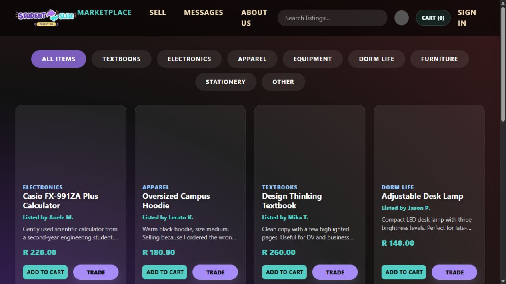
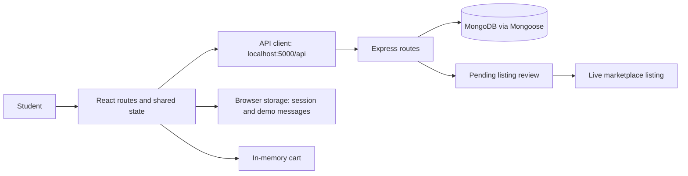
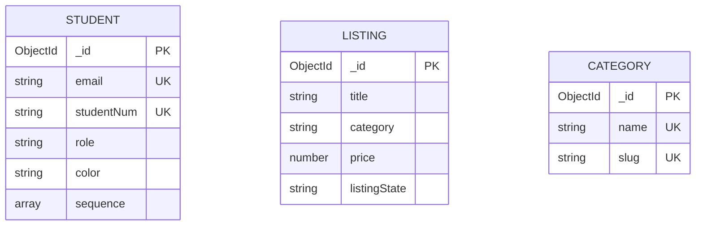

<p align="center"></p>

# StudentSlide

**Student marketplace · MERN web application · Keyboard Lickers**<br>
**Portfolio author:** Gedeon Kazadi · DV200, Semester 1 · Shared group repository

[Shared repository](https://github.com/gabri3llp/dv200_keyboardlickers_studentslide) · [Frontend source](studentslide/src) · [Backend source](studentslide/Backend)

## Contents

- [About the project](#about-the-project)
- [Getting started](#getting-started)
- [Features](#features)
- [Development process](#development-process)
- [Team contributions](#team-contributions)
- [Final outcome](#final-outcome)
- [Conclusion](#conclusion)
- [Credits and use terms](#credits-and-use-terms)

## About the project

StudentSlide is a student-to-student marketplace for affordable second-hand goods. Students can browse listings, create items and explore a creative colour-and-sequence sign-in flow. A moderation interface supports reviewing pending items. The project combines a React interface with Express routes and MongoDB models, while some buyer journeys remain local demonstrations. I contributed to listings, moderation and full-stack integration as part of Keyboard Lickers.

**Technologies:** React 19, React Router 7, Vite 8, React Bootstrap, Bootstrap 5, Node.js, Express 5, MongoDB/Mongoose, bcrypt and JSON Web Tokens. Both frontend and backend are in this repository.

## Getting started

### Prerequisites

- Node.js **22.12 or later** and npm for the Vite 8 frontend.
- Git and MongoDB: a local server or your own Atlas development database.
- Two terminals: one for Express and one for Vite.

### Clone and configure the backend

```bash
git clone https://github.com/gabri3llp/dv200_keyboardlickers_studentslide.git
cd dv200_keyboardlickers_studentslide
```

Copy the root `.env.example` to root `.env`. The backend explicitly loads that root file, not a file inside `Backend`.

```env
MONGO_URI=mongodb://127.0.0.1:27017/studentslide
PORT=5000
JWT_SECRET=replace_with_your_own_random_local_value
```

For Atlas, substitute your own connection string and configure its database user and network access. Keep `.env` untracked. Use a disposable development database with fictional users.

```bash
cd studentslide/Backend
npm ci
npm start
```

The server starts on port 5000 **after** MongoDB connects. Inspect the terminal if it never starts. `npm start` runs `node server.js`; the optional `dev` script requires nodemon, which is not currently declared as a dependency.

### Start the frontend

In a second terminal, from the repository root:

```bash
cd studentslide
npm ci
npm run dev
```

Open [localhost:5173](http://localhost:5173/). The API base is currently hard-coded as `http://localhost:5000/api` in [`src/api/client.js`](studentslide/src/api/client.js). Changing `PORT` therefore also requires changing that base URL. The frontend does not currently use `VITE_API_URL`.

Register a development account using the creative sign-up flow. For a local moderation demonstration, set that account’s `role` to `admin` in your own test database, then sign out and back in. There is no seeded administrator or universal demonstration password.

## Features

| Journey | Current implementation |
| --- | --- |
| Accounts | Creative colour/sequence registration and login, MongoDB user records and a JWT-backed browser session. This is a classroom prototype, not a verified-student or production-secure identity service. |
| Marketplace | Search and category filtering. The UI falls back to sample listings when no live listings are returned or the API fails. |
| Listings | Express/Mongoose endpoints create, fetch, edit and delete listing records. Creation defaults to `pending`; ownership enforcement is unfinished. |
| Moderation | Admin/moderator UI approves pending listings, unpublishes live ones and deletes rejected records through the API. Role-header fallback remains a development limitation. |
| Cart | Shared React state manages quantities and totals. Checkout is a frontend demonstration; orders and payments are not persisted. |
| Trade messages | Offers/messages are held in browser local storage. They are not delivered to another user or persisted by a messaging API. |
| Comments | No connected comments API is implemented. |



The screenshot shows the local marketplace interface. Sample listings are demonstration content, not proof of a populated or connected database.

## Development process

### Architecture and user flow



A seller creates a pending listing. A moderator reviews it and changes its state to `live`. The marketplace fetches live records, while the local sample catalogue supports interface demonstrations when the service has no data.



This diagram follows the current [Mongoose models](studentslide/Backend/Model). There is no stored seller reference on listings; category is a string, not a foreign-key relationship. Messaging and orders have no database models.

### Code decision: pending-first moderation

From [`Backend/Model/listings.js`](studentslide/Backend/Model/listings.js):

```js
listingState: { type: String, enum: ['pending', 'live'], default: 'pending' }
```

New listings enter review before publication. The state route accepts only these two values; rejecting a listing deletes it rather than storing a separate rejected status. The API restricts editable content fields so an ordinary edit does not directly set `listingState`.

### Challenges and checks

The team had to join separately developed authentication, marketplace, cart and admin screens. Shared API helpers and session state reduce inconsistent requests. Explicitly documenting local trade/cart behaviour avoids presenting a UI prototype as completed server functionality.

```bash
# Run from studentslide/
npm run lint
npm run build
npm run preview
```

The backend `npm test` script is a placeholder that exits with an error; it is not an automated test suite. End-to-end database and multi-user messaging tests are not claimed. A useful manual check is to create a fictional listing, approve it, refresh the marketplace and verify the stored state in MongoDB. Separately test the sample-data fallback with the backend stopped.

## Team contributions

The responsibilities below are recorded in the current [About Us source](studentslide/src/Pages/aboutUS.jsx); they are not inferred solely from project-management titles or commit counts.

| Member | Student number | Recorded implementation contribution | Coordination role |
| --- | --- | --- | --- |
| Gabriel Pulella | 251298 | Backend and database work supporting the core data flow. | Git Manager |
| Larissa Heyns | 251048 | Authentication and the creative login/user flow. | Meeting Planner |
| Gedeon Kazadi | 21100471 | Full-stack integration for listings, admin moderation, marketplace and merge planning. | Admin Manager |
| Nkanyiso Nkosi | 251306 | Marketplace and cart work supporting the buyer experience. | Project Manager |

## Final outcome

The shared repository contains both services and the local setup above. A deployed StudentSlide URL has not been verified, so none is presented as a working release.

**Demo video:** the required 5–8 minute recording has not yet been linked.

## Conclusion

StudentSlide brought four contributors’ screens into a shared marketplace journey. My main learning was coordinating data contracts and moderation behaviour across the interface and backend.

Future work includes server-enforced permissions and listing ownership, private production JWT configuration, real message delivery, persisted carts/orders, removal or clearer labelling of fallback data, and automated integration coverage. These remain improvements rather than completed features.

## Credits and use terms

- **Team:** Keyboard Lickers — Gabriel Pulella, Larissa Heyns, Gedeon Kazadi and Nkanyiso Nkosi.
- **Portfolio contact:** [Gedeon Kazadi](https://github.com/GKaz17) · [21100471@virtualwindow.co.za](mailto:21100471@virtualwindow.co.za)
- **Scaffolding and libraries:** [Vite](https://vite.dev/), [React](https://react.dev/), [React Router](https://reactrouter.com/), [Bootstrap](https://getbootstrap.com/), [React Bootstrap](https://react-bootstrap.github.io/), [Express](https://expressjs.com/), [MongoDB](https://www.mongodb.com/) / [Mongoose](https://mongoosejs.com/), bcrypt, JSON Web Tokens, dotenv and cors. Versions are retained in the package manifests and lockfiles.
- **Design and assets:** Existing StudentSlide logos, team portraits and interface assets are retained. The sample catalogue contains externally hosted product images; original image-source attribution still needs a team review. No unverified image ownership is claimed.
- **Use terms:** Shared academic/portfolio work. No repository-wide open-source licence is present; the backend package declares ISC, but this does not establish a licence for all team assets. Third-party resources retain their original rights. Any additional borrowed templates or assets still require their original creator credits.
